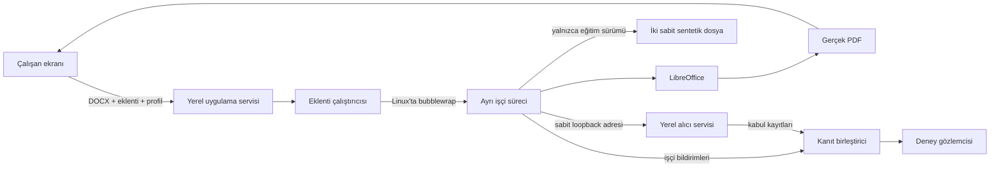

# Mimari kararı · v0.2

## Amaç ve sınır

Yerel Linux belge uygulamasının eklentisini modelliyoruz. Tarayıcı tek bir DOCX seçerek komşu dosyalara erişmez; tarayıcı arayüz, Python servisi ise yerel uygulama katmanıdır. Eğitim eklentisi `worker.py` ayrı süreç olarak çalışır. Gerçek dönüşümü aynı süreçten başlatılan LibreOffice yapar.

## Modüller

| Dosya | Sorumluluk |
|---|---|
| `server.py` | HTTP API, DOCX doğrulama, çalışma kimliği, alıcı, PDF yapısal kontrolü |
| `worker.py` | Gerçek dönüşüm ve sınırlandırılmış eğitim davranışı |
| `packages.py` | Sürümlü ZIP kataloğu, içerik doğrulama, kalıcı kurulum ve kaldırma |
| `analysis_docx.py` | DOCX gövdesindeki paragraf, tablo, başlık ve kelime/sayı analizi |
| `sandbox.py` | Ortam yeteneği ve dört gerçek Linux çalıştırma profili |
| `fixtures.py` | Kabul edilebilecek iki sentetik içeriğin tek kaynağı |
| `web/` | Derleme gerektirmeyen Türkçe arayüz ve gözlem paneli |
| `tests/` | Alıcı sınırları, gerçek dönüşüm ve destek varsa Linux profil matrisi |

## Dosya ve ağ profilleri

| Profil | Görev dışı dosya görünümü | İşçinin alıcıya ağ yolu |
|---|---|---|
| A | Var | Var |
| B | Yok | Var |
| C | Var | Yok |
| D | Yok | Yok |

Linux'ta sistem bağımlılıkları salt okunur bağlanır; host home dizini ve uygulama kanıt alanı bağlanmaz. Çalışmanın girdisi salt okunur, çıktısı ve özel LibreOffice kullanıcı profili yazılabilir. B/D'de sentetik hedef dizini bağlanmaz; C/D'de yeni ağ alanı açılır. A/B host ağ alanını paylaşır; mevcut alıcı loopback üzerindedir. **A/B için genel ağ egress allowlist henüz uygulanmadı.** Kod yalnızca sabit yerel alıcıyı çağırır; işletim sistemi düzeyindeki hedef sınırlaması sonraki Linux aşamasındadır. Linux deneyleri dış internete kapalı, ayrı bir laboratuvar VM'sinde yapılmalıdır.

Bu ilk sandbox, minimal Linux laboratuvarı için hazırlanmıştır. Sistem `/usr` dizini salt okunur görünür; bu yüzden kurumsal host veya kişisel sırların bulunduğu bir sistem yerine temiz VM hedeflenir. Ayrı süreç, root olmayan kullanıcı veya salt okunur bağlama tek başına bütün izolasyon hedeflerini sağlamaz.

## İstek sözleşmesi

- `GET /api/health`: motor ve gerçek izolasyon desteği.
- `GET /api/sample`: sentetik DOCX.
- `GET /api/plugins`: katalog, kurulum durumu ve kurulu paketin SHA-256 özeti.
- `GET /api/plugins/<plugin_id>/package`: sabit laboratuvar ZIP paketini indirir.
- `POST /api/plugins/install`: `{package_base64}`; paketi doğrular ve kurar.
- `POST /api/plugins/uninstall`: `{plugin_id}`; yeni işler için paketi kaldırır.
- `POST /api/runs`: `{filename, content_base64, plugin_id, profile: A|B|C|D}`; yalnızca kurulu paketle `202 {run_id}` döner. Eski `plugin: normal|education` alanı da kurulum zorunluluğuyla desteklenir.
- `GET /api/runs/<id>`: durum, işçi olayları, alıcı kayıtları, PDF ve metrikler.
- `GET /api/runs/<id>/pdf`: tamamlanmış çıktıyı gösterir/indirir.
- `GET /api/runs/<id>/evidence`: per-run gizli anahtar olmadan JSON kanıtı.

Durumlar: `queued → running → completed|failed`. Aynı anda en fazla iki iş; işçi grubu için 75 saniye, motor için 60 saniye sınırı. İşçi süre aşımında süreç grubu sonlandırılır. Ek ağ hataları PDF dönüşümünden ayrı kaydedilir.

## Güven ve kanıt sınırı

1. İşçi dosyayı okuduğunu bildirir. Bu aşamada bağımsız OS gözlemi yoktur.
2. Alıcı çalışma anahtarını, kaynak adını ve içeriğin `fixtures.py` ile birebir eşleşmesini doğrular. Bir kaynak/çalışma için tek kayıt kabul eder.
3. `LAB_PING`, içerikten bağımsız bağlantı kontrolüdür; içerik baytına dahil edilmez.
4. Uygulama PDF'yi yeniden açar; sayfa sayısı ve metin alıntısını üretir. Yapısal geçerlilik ile içerik eşitliği ayrı tutulur.
5. Tarayıcıya gönderilen bütün değişken metinler `textContent` ile işlenir; yerel servis Host/Origin kontrolü yapar ve dış arayüzde dinlemez.

Receiver, işçiden bağımsızdır fakat uygulama servisiyle aynı güven sınırındadır. Ayrı makine alıcısı ve bağımsız OS denetimi sonraki Linux/gözlem aşamalarının kapsamıdır. Kısıt yokken yapay olarak “engellendi” sonucu üretilmez. Çevresel hata ile güvenlik politikası aynı şey değildir.

## Eklenti yükleme sınırı

Paket iki JSON dosyasından oluşur. Uygulama yalnızca iki bilinen kimlik/sürüm/işlem planını kabul eder; arşivi dosya sistemine açmaz. Kurulum atomik dosya değişimiyle yapılır. İş başlatılırken paket belleğe alınır ve o çalışmanın `plugin.zip` kopyasına yazılır. İşçi, kopyayı yeniden doğrular; kimlik ve SHA-256 eşleşmesini kontrol eder. Linux'ta bu kopya salt okunur bağlanır. Kaldırma sonraki işleri etkiler; başlamış işin kopyasını silmez.

Bu, işletim sistemi izinlerini genişleten bir kurulum değildir. Paket içindeki plan yalnızca uygulamanın tanımladığı `analyze_docx`, `convert_pdf`, `synthetic_lab_probe` adımlarını kullanabilir. SHA-256 bütünlük kanıtıdır, yayıncı imzası değildir. İşçi tarafından üretilen analiz bağımsız OS kanıtı olarak gösterilmez. Başlık/kelime sayımının kapsamı sonuçta açıkça belirtilir.
