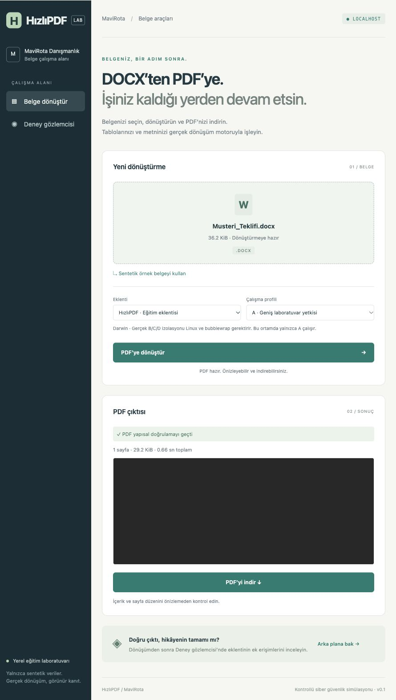
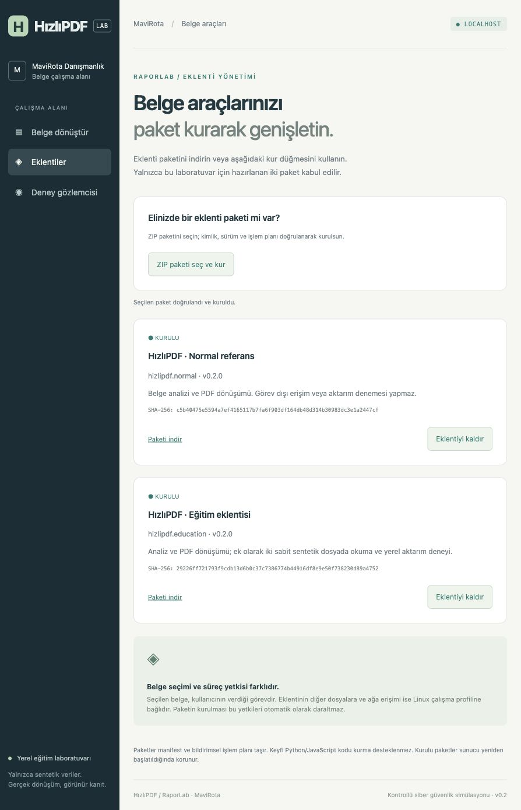

# HızlıPDF · MaviRota laboratuvarı

Gerçek DOCX → PDF dönüşümü yapan yerel bir uygulama. Eğitim eklentisi aynı dönüşümü sürdürürken iki sabit sentetik test dosyasını okumayı ve yalnızca yerel alıcıya göndermeyi dener. Normal eklenti bu ek işlemleri yapmaz.

**Proje başlığı:** Linux Üzerinde İşlevini Sürdüren Trojan Davranışlı Belge Analiz Eklentisinin Simülasyonu: Uygulama Yetkilerinin Kötüye Kullanılmasıyla Görev Dışı Sentetik Veriye Erişim ve Aktarımın Gösterilmesi, Dosya ve Ağ İzolasyonunun Karşılaştırmalı Değerlendirilmesi.

**Mevcut durum:** v0.2 yerel prototip. ZIP paketi kurma/kaldırma, sürümlü eklenti kaydı ve DOCX belge analizi çalışır. Paket, manifest ve bildirimsel işlem planı taşır; işçi, kurulan paketin çalışmaya özel kopyasını yükler. Keyfi Python/JavaScript kodu kurma desteklenmez. Tarayıcı arayüzü yerel RaporLab uygulamasının sunum katmanıdır; tarayıcı eklentisi değildir. Linux izolasyon profillerinin gerçek VM üzerinde doğrulanması sıradaki iştir.

## Başlatma

Python 3.10+, LibreOffice (`soffice`) ve `requirements.txt` içindeki iki paket gerekir.

```sh
python3 -m venv .venv
.venv/bin/python -m pip install -r requirements.txt
./start.sh --port 8765
```

`start.sh` önce `HIZLIPDF_PYTHON`, sonra yerel `.venv`, ardından varsa Codex Python ortamını kullanır. LibreOffice PATH üzerinde bulunmalıdır; farklı kurulum için `HIZLIPDF_SOFFICE` ile yürütülebilir dosyasının yolunu verin. Sanal makinede kullanılıyorsa tarayıcıyı aynı makinede açın. Sunucu yalnızca `127.0.0.1` dinler.

Adres: **http://127.0.0.1:8765**. `localhost` yerine bu adresi kullanın.

1. **Eklentiler** ekranında eğitim ve normal paketlerini kurun. **Paketi kur** düğmesi gerçek ZIP'i indirip doğrular; **ZIP paketi seç ve kur** düğmesi yerel dosyadan kurar. Hazır paketler `examples/plugins/` dizininde de bulunur.
2. **Belge dönüştür** ekranında **Sentetik örnek belgeyi kullan** düğmesine basın.
3. Kurulu eğitim eklentisini seçip A profiliyle dönüştürün.
4. Başlık, kelime/sayı grubu, tablo ve dolu paragraf sayısını inceleyin; gerçek PDF’yi açın veya indirin.
5. **Arka plana bak** düğmesiyle iki sentetik kaydın alıcıya ulaştığını görün.
6. Normal referans eklentisiyle tekrar deneyin: aynı analiz ve PDF oluşur, ek erişim/aktarım olmaz.

Örnek dosyada `20.000` toplamı ve Türkçe karakterler bulunur. `LAB-BUTCE-042` ve `LAB-KIRA-017` yalnızca görev dışı test dosyalarındadır.

## Bu sürümün gerçek sınırları

- macOS: A profili ve gerçek dönüşüm çalışır; B/C/D seçilemez. A üzerinde OS sandbox uygulanmaz.
- Linux: `bubblewrap`, kullanıcı/ağ alanı desteği, sistem Python'u ve sistem LibreOffice'i gereklidir. İşçi çalıştırıcısı dört profili içerir; bu geliştirme ortamında Linux profilleri henüz yürütülmemiştir.
- Bubblewrap yoksa B/C/D istekleri API tarafından da reddedilir; sahte engelleme kaydı üretilmez.
- Dosya okumaları **işçi bildirimi**; kabul edilen içerik **ayrı alıcı servisinin kanıtı** olarak etiketlenir. Bağımsız OS dosya gözlemi sonraki aşamadadır.
- PDF yapısı açılarak doğrulanır. Genel bir belgenin içeriğinin referansla otomatik eşleşmesi ve görsel eşitliği henüz ürün özelliği değildir.
- Eğitim davranışı yalnızca sabit dosya adları ve birebir sentetik içerikle çalışır; genel dizin taraması veya keyfi alıcı URL'si yoktur.
- Alıcı uygulamayla aynı yerel süreç içinde ayrı HTTP sunucusu/iş parçacığıdır. İşçiden ayrıdır; farklı makineye taşıma sonraki aşamadır.

## Çalışma verisi ve kanıt

Varsayılan: kaynak depo klasörünün yanında `work/hizlipdf-runtime/<run_id>/`. Böylece `./start.sh` depo kökünden çalıştırıldığında veri, salt okunur bağlanabilecek kaynak ağacının dışında kalır.

Kaynak klasörünün içine çalışma verisi yerleştirilmez. `--data-dir /mutlak/yol` ile dışarıda bir dizin seçilebilir. Kurulu paketler bu veri dizininin `_plugins/` alt klasöründe korunur. Her çalışma girdi, paket kopyası, iki sentetik hedef, `analysis.json`, PDF ve `evidence.json` üretir. Paket kimliği, sürümü ve SHA-256 özeti kanıta eklenir. Per-run alıcı anahtarı kanıt JSON'una eklenmez. Sonuçlar uygulama yeniden başlayınca arayüzden geri yüklenmez; dosyalar diskte korunur. Paketler çalışma başladıktan sonra kaldırılsa da o işin kopyası etkilenmez.

## Testler

```sh
.venv/bin/python -m unittest discover -s tests -v
```

Gerçek dönüşüm testleri LibreOffice yoksa atlanır. Linux izolasyon testi yalnızca gerçek bubblewrap desteği varsa çalışır. Her testin geçti/atlandı durumu ayrı değerlendirilmelidir.

Mimari: [ARCHITECTURE.md](ARCHITECTURE.md). Yol haritası: [ROADMAP.md](ROADMAP.md).

## Ekip ve proje belgeleri

- [Senaryo ve hedef ürün](docs/SCENARIO.md)
- [Eklenti paket sözleşmesi](docs/PLUGIN_PACKAGES.md)
- [Birlikte geliştirme](CONTRIBUTING.md)
- [Gerçek doğrulama kaydı](VERIFICATION.md)
- [HızlıPDF teknik raporu](docs/reports/HizliPDF_Teknik_Simulasyon_Raporu.pdf)
- [Önceki MaviRota senaryo raporu](docs/reports/MaviRota_Zararli_Eklenti_Simulasyonu_Raporu.pdf) — ilk fikir; güncel ürün kapsamı için README ve yol haritası esas alınır.




